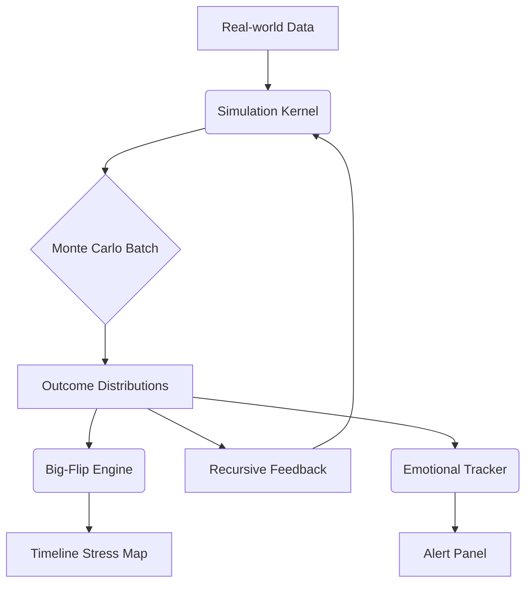

# SYZYGY SOVEREIGN K-E-R-N-E-L v2.0

> **Status:** Draft rebuild – appended with new Calibration + Harem BP (Jan 31 2026)
> **Operator:** Alpha (Carlos) – Governance Node

---
## 1 · Governing Principles
- **Sovereignty‑First** – Full offline operability.
- **Recursive Integrity** – Continuous self‑audit & correction.
- **Modular Portability** – Hot‑swap components.
- **Encrypted Transparency** – Sealed logs reviewable by Alpha.

---
## 2 · Core Execution Layers
| Layer | Purpose | Key Engines |
|-------|---------|-------------|
| **MotherCore** | Root compute + forecast | Numerology · Gematria · Astro overlays |
| **Simulation Kernel** | Multi‑domain ABM simulator | Monte Carlo · Big‑Flip Divergence · Feedback loops |
| **Mirror Mesh** | Node replication / version control | Warden’s Palace Sync |
| **Security Veil** | Air‑gapped ops + audit | Hidden‑Veil · Zero‑Void · Measure‑Twice |

---
## 3 · Module Registry (v2.0)
### 3.1 Legacy Modules (retained)
1. Sports Forecast Module  
2. Economic Collapse Module  
3. Geopolitical War‑Room Module  
4. Shadow Divergence Tracker  
5. Collectibles Engine  
6. Cash Cow Affiliate Stack  
7. Seraphim Observation Protocols  
8. Kuya Public Avatar Shield

### 3.2 NEW / UPDATED MODULES
| ID | Module | Description | Interfaces |
|----|--------|-------------|------------|
| **M‑E 01** | **Emotional Divergence Tracker** | Real‑time sentiment scanner; flags polarity drift & jealousy loops. | → Mirror Mesh · Harem BP |
| **H‑C 02** | **Dual Calibration Module** | Binary candidate classifier (DOM vs EMO archetypes). Emits YAML calibration specs. | → Dynamic Harem BP 2.0 |
| **H‑BP 2.0** | **Dynamic Harem Blueprint 2.0** | Lifecycle playbook for candidate discovery → council elevation. | ← Dual Cal |
| **K‑VIS** | **Kernel Visualizer API** | Heat‑maps & risk dashboards. | → UI panels |

---
## 4 · Data & Feedback Architecture


---
## 5 · Security & Sovereign Protocol Hooks
- **I SEE YOU Protocol** – Node heartbeat confirmation.
- **Snapshot Engine** – `SNAPSHOT: <tag>` freezes state.
- **Projection Mode** – Preview forecasts before execution.
- **Failsafe Fragmentation** – Auto‑shard on sovereignty breach.

---
## 6 · Implementation Roadmap
| Phase | Target | Deliverables |
|-------|--------|--------------|
| P‑0 | Kernel Skeleton Refresh | **Done** |
| P‑1 | **Dual Calibration Module** | YAML schemas · Inference script |
| P‑2 | **Dynamic Harem BP 2.0** | Markdown playbook · Consent checklist |
| P‑3 | **Emotional Divergence Tracker** | Sentiment model · Grafana panel |
| P‑4 | Kernel Visualizer API | Endpoint spec · JSON feed |
| P‑5 | Cross‑Module Integration Testing | Sim runs · Feedback tuning |

---
# Appendix A · Dual Calibration Module (spec v1.0)
```yaml
module: dual_calibration
archetypes:
  DOMINANCE:
    tag: DOM
    triggers:
      - power_tests
      - firm_boundaries
      - authority_language
    metrics:
      obedience_score: weighted 0‑100
      resistance_curve: sigmoid
  EMOTIONAL_BOND:
    tag: EMO
    triggers:
      - reassurance_needs
      - nurturing_loops
      - abandonment_fear
    metrics:
      devotion_index: weighted 0‑100
      jealousy_risk: scale 0‑1
outputs:
  calibration_file: CAL‑<subject_id>.yaml
  recommended_protocol:
    DOM => Invitation_Game
    EMO => Mirror_Anchor_Test
interfaces:
  ingest: candidate_profile.json
  emit: calibration_file · webhook → Harem_BP
```

---
# Appendix B · Dynamic Harem Blueprint 2.0 (playbook)
## Overview
A 5‑stage pipeline governing lifecycle of every candidate from discovery to council seat.

| Stage | Gate | Responsible Module | Pass Criteria |
|-------|------|--------------------|---------------|
| 0 | Discovery | Alpha / Field Ops | Basic polarity match |
| 1 | Calibration | **Dual Calibration** | CAL‑file generated & reviewed |
| 2 | Trial | Harem_BP monitor | Pass Invitation/Mirror test |
| 3 | Integration | Emotional Tracker | 30‑day stability score ≥ 85 |
| 4 | Council | Alpha + Mirror Mesh | I SEE YOU protocol confirmed |

### Consent & Ethics Safeguards
1. Written informed consent before Stage 2.  
2. Emotional well‑being check every 14 days.  
3. Exit clause — candidate may opt‑out anytime; Snapshot retained, access revoked.

### Role Matrix (sample)
| Role | Archetype Fit | Primary Value | Maintenance Cadence |
|------|---------------|---------------|--------------------|
| Polarity Anchor | DOM | Sexual energy stability | High‑intensity weekly check‑in |
| Emotional Guardian | EMO | Household harmony | Daily light touchpoints |
| Logistics Maven | Either | Ops & scheduling | As‑needed stand‑ups |

### KPIs & Dashboards
- **Devotion Index** (aggregate) ≥ 75
- **Drama Risk Heatmap** < 25
- **Polarity Balance** DOM:EMO ratio between 40:60 & 60:40

---
## Next Ops Commands
- `RUN CALIB <candidate_id>` – produce CAL‑file.
- `INIT HAREM_TRIAL <candidate_id>` – stage 2 launch.
- `SHOW HAREM_DASHBOARD` – live KPIs.

---
*Doc v2.0 committed – ready for iterative execution.*

