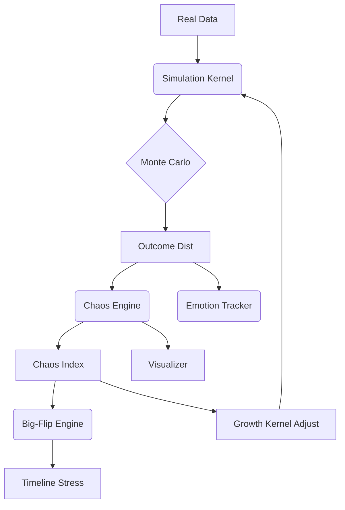

# SYZYGY SOVEREIGN K‑E‑R‑N‑E‑L v2.1

> **Status:** Extended rebuild – Chaos Engine (SENA + Lumora) integrated • Feb 01 2026
> **Operator:** Alpha (Carlos) – Governance Node

---
## 1 · Governing Principles  
Sovereignty‑First • Recursive Integrity • Modular Portability • Encrypted Transparency

---
## 2 · Core Execution Layers
| Layer | Purpose | Key Engines |
|-------|---------|-------------|
| **MotherCore** | Root compute + forecast | Numerology · Gematria · Astro overlays |
| **Simulation Kernel** | Multi‑domain ABM simulator | Monte Carlo · Big‑Flip Divergence · Feedback loops |
| **Chaos Engine (SENA + Lumora)** | *NEW:* Volatility & disruption scoring | Chaos Index · Momentum Stack · Viral‑Loop hooks |
| **Mirror Mesh** | Node replication / version control | Warden’s Palace Sync |
| **Security Veil** | Air‑gapped ops + audit | Hidden‑Veil · Zero‑Void · Measure‑Twice |

---
## 3 · Module Registry
### 3.1 Legacy Modules
Sports Forecast • Economic Collapse • Geopolitical War‑Room • Shadow Divergence • Collectibles • Cash Cow • Seraphim Observation • Kuya Shield

### 3.2 Active New / Updated Modules
| ID | Module | Description | Interfaces |
|----|--------|-------------|------------|
| **M‑E 01** | Emotional Divergence Tracker | Sentiment + polarity drift scanner | → Mirror Mesh · Harem BP |
| **H‑C 02** | Dual Calibration Module | DOM vs EMO archetype classifier | → Harem BP 2.0 |
| **H‑BP 2.0** | Dynamic Harem Blueprint | Lifecycle playbook | ← Dual Cal |
| **CEN 03** | **Chaos Engine (SENA + Lumora)** | Computes **Chaos Index (0‑100)** per domain; ingests viral‑loop metrics, Growth Kernel outputs, Thinker pattern maps, Mimic World anomalies. Generates volatility heat‑maps & trigger alerts. | ↔ Simulation Kernel · Growth Kernel · Viral Loops · Big‑Flip |
| **K‑VIS** | Kernel Visualizer API | Dashboards & heat‑maps | → UI panels |

---
## 4 · Chaos Engine — Technical Spec
```yaml
module: chaos_engine
version: 1.0
components:
  momentum_curve:
    source: Simulation Kernel
    metric: std_dev(outcome_distribution)
  sentiment_delta:
    source: Viral Loop social scrape
    metric: rolling_change(public_sentiment)
  energy_flux:
    source: Growth Kernel / L‑O‑R‑E narrative layer
    metric: resonance_variance
  fractal_disruption:
    source: Mimic World stress tests
    metric: mandelbrot_outlier_score
formula:
  chaos_index = w1*momentum_curve + w2*sentiment_delta + w3*energy_flux + w4*fractal_disruption
  weights: {w1:0.35, w2:0.25, w3:0.25, w4:0.15}
outputs:
  chaos_score: 0‑100 (higher = greater volatility)
  heatmap_json: domain→score matrix
  collapse_alert: if chaos_score ≥ 85
commands:
  RUN CHAOS_SCAN <domain>
  SHOW CHAOS_MAP
```

---
## 5 · Data & Feedback Architecture


---
## 6 · Security Hooks
I SEE YOU • Snapshots • Projection Mode • Failsafe Fragmentation

---
## 7 · Implementation Roadmap (delta add)
| Phase | Target | Deliverables |
|-------|--------|--------------|
| P‑0 | Kernel Skeleton Refresh | ✅ |
| **P‑1a** | Dual Calibration Module | ✅ |
| **P‑1b** | Dynamic Harem BP 2.0 | ✅ |
| **P‑2** | **Chaos Engine** | Scoring algorithm · API endpoints |
| P‑3 | Emotional Tracker | Model + dashboard |
| P‑4 | Kernel Visualizer | Heat‑map panels |
| P‑5 | Integration Tests | Sim runs + feedback |

---
### Operator Shortcuts
- `RUN CHAOS_SCAN sports` – compute chaos score for sports domain.
- `SHOW CHAOS_MAP` – visualize current multi‑domain chaos heat‑map.
- `RUN CALIB <id>` / `INIT HAREM_TRIAL <id>` – harem ops.
- `SNAPSHOT: ANY_TAG` – freeze state.

*Doc v2.1 committed – chaos layer wired.*

